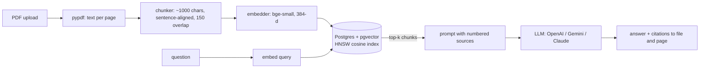

# PDF RAG with pgvector

A small retrieval-augmented generation (RAG) service over PDFs, built to be read end to end.

- **FastAPI** HTTP API: upload PDFs, semantic search, cited answers, tool-calling chat
- **PostgreSQL + pgvector**: embeddings stored next to the data, **HNSW** index for cosine search
- **Idempotent ingest**: re-uploading the same file is a no-op; a changed file replaces its chunks atomically
- **Configurable LLM**: OpenAI, Google Gemini or Anthropic Claude via one client, chosen by an env var
- **Evals**: `eval.py` reports retrieval hit-rate / MRR and answer groundedness on a labelled question set
- **Runs offline by default**: local embedding model plus an extractive baseline, so `docker compose up` works with no API key



## Quick start

Requirements: Docker with Compose.

```bash
cp .env.example .env        # optional: defaults run fully offline
docker compose up -d --build
```

The API is on <http://localhost:8080>, with interactive docs at <http://localhost:8080/docs>.
The first request that needs embeddings downloads the model (about 65 MB) into a Docker volume. Later
requests reuse it.

Run the tests (they use a separate `rag_test` database in the same Postgres container):

```bash
docker compose exec api pytest -q
```

Run the evaluation (it ingests `data/sample_pdfs/` first):

```bash
docker compose exec api python eval.py --base-url http://localhost:8000
```

To use a real LLM, set it in `.env` and restart the API container (`docker compose up -d`):

```dotenv
LLM_PROVIDER=gemini            # or openai / anthropic
LLM_MODEL=gemini-2.5-flash
LLM_API_KEY=...
```

> **Local Python without Docker** works with `uv sync` on Linux and Apple-silicon Macs. On Intel Macs,
> use Docker, because `onnxruntime` (needed by the local embedding model) no longer ships Intel-Mac
> wheels.

## API

| Method | Path | What it does |
|---|---|---|
| `POST` | `/documents` | Upload a PDF (multipart `file`). Returns `created`, `updated` or `unchanged` |
| `GET` | `/documents` | List documents with page and chunk counts |
| `DELETE` | `/documents/{id}` | Delete a document and its chunks (cascade) |
| `POST` | `/search` | `{"query", "top_k?", "filename?"}`: nearest chunks with similarity scores |
| `POST` | `/answer` | `{"question", "top_k?"}`: answer with `[n]` citations resolved to file and page |
| `POST` | `/chat` | Same, but the LLM drives retrieval through tools (needs a real LLM) |
| `GET` | `/health` | Database connectivity check |

```bash
curl -F file=@data/sample_pdfs/solar_kettle_k2_manual.pdf localhost:8080/documents
curl -s localhost:8080/answer -H 'content-type: application/json' \
     -d '{"question": "What does error code E3 mean?"}'
```

Example response with an LLM configured (abridged):

```json
{
  "answer": "Error code E3 means the water level is below the MIN line [1].",
  "citations": [{"source": 1, "filename": "solar_kettle_k2_manual.pdf", "page_number": 3, "...": "..."}],
  "sources": ["... the retrieved chunks with scores ..."]
}
```

## Design choices

### Chunking: about 1000 characters, sentence-aligned, 150 characters of overlap, never across pages

- **Size.** 1000 characters is roughly 200–250 tokens. That is well under the embedding model's
  512-token input limit, so nothing gets silently truncated. It is also small enough that one chunk is
  usually about one topic, which gives sharper vectors and more precise citations. Larger chunks give
  the LLM more context per hit, but they dilute the embedding and cost more prompt tokens.
- **Sentence-aligned.** The chunker packs whole sentences greedily and only splits a sentence when
  that one sentence is longer than a chunk (`app/chunking.py`). Cutting mid-sentence produces
  fragments that embed poorly.
- **Overlap.** Each chunk starts with the last sentence or two (up to 150 characters) of the previous
  chunk, so a fact that sits on a boundary still appears whole in at least one chunk.
- **Per page.** A chunk never crosses a page break, so each chunk has exactly one page number to cite.
- Size and overlap are configurable (`CHUNK_SIZE`, `CHUNK_OVERLAP`) because the right values depend on
  the documents. The eval script is how you would compare settings.

### Embeddings: local `bge-small-en-v1.5`, 384 dimensions

- It runs locally through [fastembed](https://github.com/qdrant/fastembed) (ONNX, no PyTorch), so the
  project works without an API key and ingesting costs nothing.
- The vector column is a fixed `vector(384)`. OpenAI's `text-embedding-3-small` is also supported,
  using its `dimensions=384` parameter so it fits the same column.
- Each document stores the `embedding_model` that produced its vectors. Vectors from different models
  are not comparable, so switching models makes the next upload of a file re-embed it instead of
  skipping it.

### Idempotent re-ingest

A document's identity is its filename. Its content identity is the SHA-256 of the file bytes
(`app/ingest.py`):

| Upload | Result |
|---|---|
| New filename | `created` |
| Same filename, same bytes, same embedding model | `unchanged`. Nothing is parsed, embedded or written |
| Same filename, different bytes (or model) | `updated`. Old chunks are deleted and new ones inserted in **one transaction** |

Concurrency is handled by the database rather than by application locks. The authoritative step is
`INSERT … ON CONFLICT (filename) DO NOTHING`, followed by `SELECT … FOR UPDATE` on the document row.
Two simultaneous uploads of the same file are serialised by Postgres: one creates the document and the
other sees the matching hash and returns `unchanged`. A test runs four concurrent uploads and checks
that exactly one document, with one copy of each chunk, is created. The slow work (parsing and
embedding) happens *before* that transaction, so no row lock is held while the model runs. A cheap
hash pre-check lets most re-uploads skip that work entirely.

### HNSW index

```sql
CREATE INDEX ix_chunks_embedding_hnsw ON chunks
USING hnsw (embedding vector_cosine_ops) WITH (m = 16, ef_construction = 64);
```

- **Why an index at all.** Without one, every query compares the query vector with every chunk
  (exact, but O(n)). HNSW is an approximate nearest-neighbour graph. Queries stay fast as the table
  grows, at the cost of occasionally missing a true neighbour.
- **Why HNSW rather than IVFFlat.** IVFFlat needs data in the table before you build it (it clusters
  the existing vectors), and it degrades as data drifts unless you rebuild it. HNSW can be created on
  an empty table, handles inserts incrementally, and generally gives better recall for the same speed.
  The trade-offs are slower builds and more memory.
- **`vector_cosine_ops`** matches the query operator `<=>` (cosine distance). The index is only used
  when the operator class and the operator agree. The tests check the planner actually picks the index.
- **`m = 16, ef_construction = 64`** are pgvector's defaults, written out so they are a visible choice.
  `m` is the number of links per node; `ef_construction` is the candidate-list size while building.
- **`hnsw.ef_search`** (the query-time candidate list, default 40) is set per query with `SET LOCAL` to
  `max(40, 2 × top_k)`, because HNSW cannot return more rows than `ef_search`.
- **Filtered search** (`filename=…`) turns on pgvector's iterative index scans for that query. Without
  them, a selective `WHERE` clause applied after the index scan can return fewer than `top_k` rows.

### Answers and citations

- Retrieved chunks are numbered `[1]…[k]` in the prompt along with their file and page. The system prompt
  tells the model to cite every factual sentence, to answer "I don't know based on the provided
  documents." when the sources don't cover the question, and to treat source text as data rather than
  instructions (basic prompt-injection hygiene).
- The service parses the `[n]` markers and resolves them back to chunk, file and page. Numbers that don't
  match a retrieved source are dropped, so the API never returns a citation that points at nothing.
- If nothing is retrieved, the service answers "I don't know" without calling the LLM.
- Every LLM call has a bounded `max_tokens`, a timeout and a retry limit. `temperature=0` is used for
  OpenAI and Gemini. It is omitted for Anthropic, because recent Claude models reject values below 1 on
  the OpenAI-compatible endpoint (`LLM_TEMPERATURE` overrides this).

### Tool calling (`/chat`)

`/answer` retrieves once using the user's exact words. `/chat` instead gives the model two tools
(`app/chat.py`):

- `search_documents(query, filename?, top_k?)`: the model can rephrase, search several times (for
  example, once per side of a comparison question), or restrict the search to one document.
- `list_documents()`: lets the model see what it can search before it searches.

The loop runs at most `MAX_TOOL_ROUNDS` rounds (default 4). On the final round the request sets
`tool_choice="none"` and adds a plain instruction to answer now, which forces a text answer. (The
instruction is there because not every provider documents `tool_choice="none"`.) Tool arguments are validated and clamped (non-empty
query, `top_k ≤ 8`). Unknown tools return an error message to the model instead of crashing. Every
passage the model sees gets one global source number, so citations from different searches don't
collide. The response includes a `tool_trace` showing which tools were called.

### One client, three providers

OpenAI, Gemini and Anthropic all expose an **OpenAI-compatible Chat Completions endpoint**, tool
calling included. So `app/llm.py` is a single client with a per-provider `base_url`, not three SDKs.
The trade-off: compatibility layers don't expose every provider-specific feature. Anthropic describes
its compatibility layer as mainly for testing and comparison, and recommends its native API for
production. For this project, one small, testable code path was worth more than those features.
`LLM_BASE_URL` points the client at any other compatible server (for example, a local model).

## Evaluation

`data/eval/questions.jsonl` has 20 questions about the three sample PDFs, which are fictional and
written for this repo so that every answer is checkable. 18 questions are labelled with the file and
page that answer them; 2 are deliberately unanswerable.

| Metric | Meaning |
|---|---|
| `hit_rate@1`, `hit_rate@k` | Share of answerable questions whose labelled page is the top result / in the top k |
| `mrr` | Mean reciprocal rank of the labelled page |
| `answer_match` | Share of answers containing the expected key fact (e.g. "48 hours") |
| `groundedness` | Share of answer sentences whose content words are mostly (≥ 60%) found in the passages they cite |
| `citation_rate` | Share of answer sentences that carry a valid citation |
| `abstention` | Share of unanswerable questions answered with "I don't know" |

**Groundedness is a lexical proxy, not an LLM judge** (`app/evaluation.py`). It reliably catches
invented numbers and names, but not a paraphrase that changes the meaning. It was chosen because it is
deterministic, free, and simple to reason about. An LLM-as-judge metric is the natural next step.

Results measured with the offline defaults (bge-small embeddings + extractive baseline, `top_k=5`):

| hit_rate@1 | hit_rate@5 | mrr | answer_match | groundedness | citation_rate | abstention |
|---|---|---|---|---|---|---|
| 0.89 | 1.00 | 0.94 | 0.72 | 1.00 | 1.00 | 0.00 |

How to read these honestly:

- **Retrieval is the meaningful number.** The right page is ranked first for 16 of 18 questions. The
  corpus is tiny (12 chunks), though, so this shows the pipeline works, not that it scales. A real
  evaluation needs a larger, messier corpus.
- **The extractive baseline is a floor, not the product.** It quotes the source sentences that share
  the most words with the question. So groundedness is 1.00 by construction, it cannot say "I don't
  know" (abstention 0.00), and it misses answers phrased differently from the question ("descaled" vs
  "Descale"). These are exactly the gaps an LLM closes. Run the same script with `LLM_PROVIDER` set to
  compare.

## Project layout

```
app/
  main.py        FastAPI routes, request limits, error mapping
  config.py      settings from env (pydantic-settings)
  pdf.py         pypdf text extraction, page limit, encrypted/invalid PDF handling
  chunking.py    sentence-aligned chunking with overlap
  embeddings.py  fastembed (local) and OpenAI embedders
  ingest.py      idempotent ingest pipeline
  retrieval.py   pgvector cosine search, ef_search, filtered search
  answer.py      prompt, citations, extractive baseline
  chat.py        tool-calling loop and tools
  llm.py         OpenAI-compatible client for OpenAI / Gemini / Claude
  evaluation.py  metrics used by eval.py (unit-tested)
alembic/         migrations (pgvector extension, tables, HNSW index)
tests/           pytest: unit tests + integration tests against real Postgres/pgvector
eval.py          evaluation script
data/            sample PDFs and the labelled question set
scripts/         generator for the sample PDFs
```

## Testing approach

- Integration tests run against **real Postgres with pgvector**, not SQLite or mocks, because the
  behaviour that matters (vector operators, the HNSW index, `ON CONFLICT`, row locks) only exists there.
  The test session runs the Alembic migration down and up, so the migration is tested too.
- The embedding model and the LLM are replaced with deterministic fakes (`tests/fakes.py`): a hashed
  bag-of-words embedder and a scripted LLM. The real LLM client is tested against a mocked HTTP
  transport, which checks the request format and the tool-call parsing without network access or a key.

## Limits and safety

- Uploads are limited to 20 MB and 300 pages. Questions are limited to 2000 characters and `top_k` to 20.
  The tool loop is bounded.
- No secrets are in the repo: keys come from the environment (`.env` is git-ignored, and
  `.env.example` documents every variable). Keys are held as `SecretStr`.
- Provider errors are logged by type only, never with the request body (which contains document text).
  The API returns a generic 502.
- The container runs as a non-root user.

## What I would add for production

- **Background ingestion** (Celery + Redis). Ingest is synchronous today, which is fine for small PDFs
  but would block a request for large ones.
- **Authentication and tenant isolation**: a `tenant_id` on documents and chunks, enforced in every
  query (or with Postgres row-level security).
- **Hybrid retrieval**: Postgres full-text search plus vectors, fused with reciprocal-rank fusion, then
  a cross-encoder reranker. Keyword search catches exact terms like error codes that embeddings can blur.
- **OCR** for scanned PDFs. Today they are rejected with a clear error.
- **LLM-as-judge groundedness**, and a larger evaluation set, run in CI to catch regressions.
- **Running migrations as a separate deploy step** instead of on container start, once there is more
  than one replica.

## License

MIT
